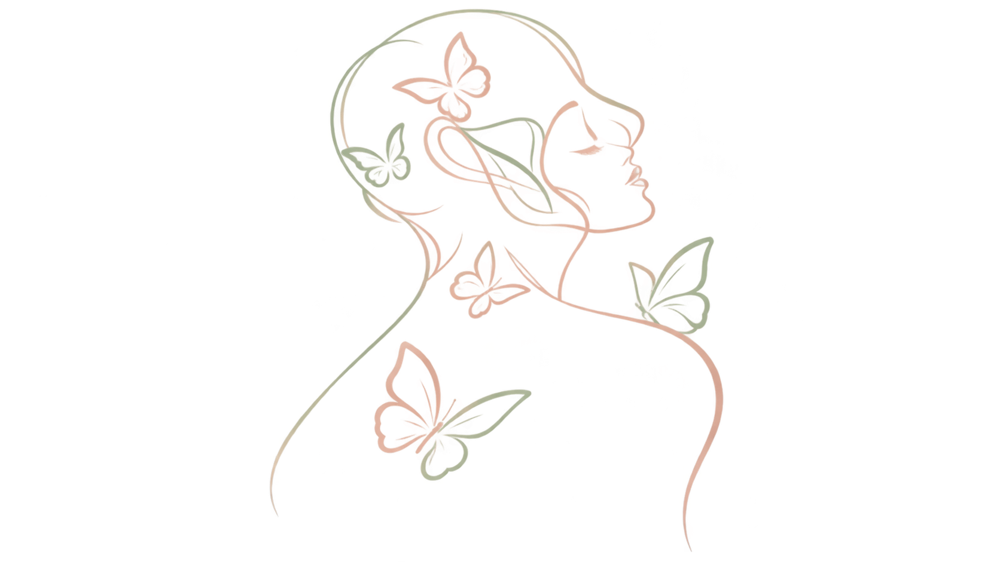

# 🌿 Shaylla Correa | Psicologia Clínica


<p align="center">
  <picture>
    
  </picture>
</p>


<p align="center">
  <strong>Um espaço de acolhimento, autoconhecimento e cuidado emocional.</strong>
</p>

<p align="center">
  Projeto de desenvolvimento Front-end para apresentação profissional de uma psicóloga clínica.
</p>

---

## 📌 Sobre o projeto

O projeto consiste no desenvolvimento de um site institucional para uma profissional da área de Psicologia Clínica, com foco em proporcionar uma experiência visual acolhedora, intuitiva e acessível aos visitantes.

A proposta é apresentar os serviços profissionais, disponibilizar informações sobre saúde emocional e oferecer uma interface que permita ao visitante explorar diferentes conteúdos e expressar como está se sentindo.

O design utiliza elementos visuais, cores suaves e uma organização intuitiva para transmitir uma sensação de acolhimento e tranquilidade.

## ✨ Funcionalidades

- **Página inicial:** apresentação da profissional e proposta do site.
- **Navegação responsiva:** menu adaptável para dispositivos móveis.
- **Acolhimento emocional:** seleção de sentimentos e campo para escrita livre.
- **Conteúdo informativo:** apresentação de temas relacionados à saúde emocional e ao autocuidado.
- **Apresentação profissional:** seção dedicada à formação e atuação da psicóloga.
- **Depoimentos:** carrossel com navegação entre os conteúdos demonstrativos.
- **Contato:** atalhos para WhatsApp e Instagram da profissional.

## 🛠️ Tecnologias utilizadas

### Front-end

- HTML5 — estruturação do conteúdo.
- CSS3 — estilização, layout e responsividade.
- JavaScript — interatividade e manipulação dos elementos da página.

### Ferramentas

- Visual Studio Code.
- Git.
- GitHub.
- GitHub Pages (publicação, quando configurada).

## 📂 Estrutura do projeto

```text
site.ps/
│
├── index.html
├── style.css
├── script.js
│
└── assets/
    ├── imagens
    └── elementos visuais
```

## 🚀 Como executar o projeto

1. Clone o repositório:

```bash
git clone https://github.com/henriqueqodev/site.ps.git
```

2. Acesse a pasta do projeto:

```bash
cd site.ps
```

3. Abra o arquivo `index.html` no navegador.

Para facilitar o desenvolvimento, recomenda-se utilizar a extensão **Live Server** no Visual Studio Code.

## 📱 Responsividade

A interface foi desenvolvida considerando diferentes tamanhos de tela, buscando proporcionar uma experiência consistente em computadores, tablets e smartphones.

## ⚠️ Observações

Este projeto é uma implementação Front-end.

O formulário de acolhimento é demonstrativo e não realiza envio ou armazenamento de informações. Para utilização em ambiente de produção, será necessária a implementação de uma estrutura de backend segura, mecanismos de consentimento e medidas adequadas de proteção de dados e conformidade com a LGPD.

As informações profissionais, credenciais e depoimentos demonstrativos devem ser confirmados pela profissional antes da publicação.

## 👨‍💻 Desenvolvimento

Projeto desenvolvido como uma aplicação web institucional, utilizando tecnologias fundamentais do desenvolvimento Front-end.

---

<p align="center">
  Desenvolvido com dedicação e aprendizado contínuo. ♡
</p>